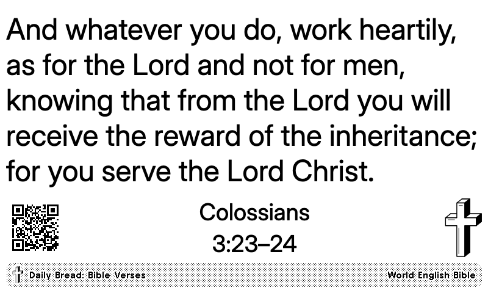
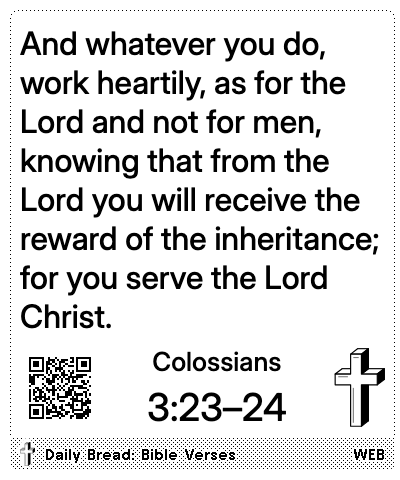
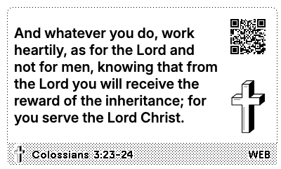
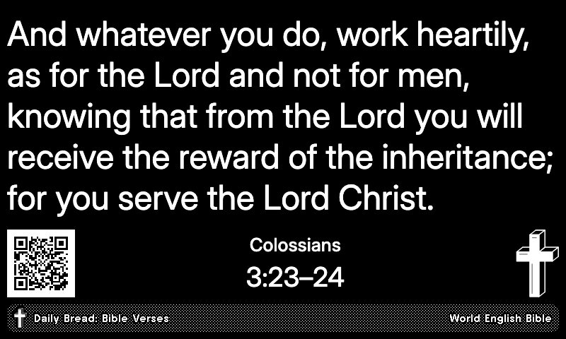
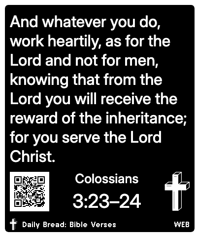
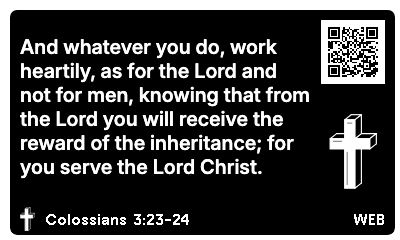

# Daily Bread: Bible Verses

Daily Bible verses for your TRMNL. One complete passage to carry into your day, with a distinctive cross and a collection chosen for everyday Christian life.

Choose from ten Bible translations in seven languages, enjoy a mix of nine practical themes, and scan the optional QR code to read the full chapter. Daily Bread fetches the chosen translation's passages from this public repository; no Bible API key or separate Bible subscription is needed.

The [listing icon](assets/icon.png) and its [SVG source](assets/icon.svg), publication titles, descriptions, localized overview copy and search/share metadata are ready in the [listing copy](docs/listing.md). The [collection review](docs/content-review.md) records source verification and the completed editorial revision.



## MVP

- **108 passages**, with 12 in each of nine practical themes: Family & home, Relationships, Work & purpose, Money & generosity, Decisions & direction, Worry & rest, Hard times & loss, Joy & gratitude, and Faith & prayer.
- **Every theme** by default, interleaved so successive intervals move between themes. Users can choose one or several themes with [TRMNL’s native multi-select](https://help.trmnl.com/en/articles/10513740-custom-plugin-form-builder); leaving it empty keeps the mix.
- **Ten translations in seven languages**, listed in [`content/translations.json`](content/translations.json) and offered in one **Bible translation** setting grouped by language (“English · King James Version (KJV)”):

  | Language | Translations |
  | --- | --- |
  | English | [World English Bible](https://worldenglish.bible/) (default, updated LORD edition), [Berean Standard Bible](https://ebible.org/bible/details.php?id=engbsb), [King James Version](https://ebible.org/bible/details.php?id=eng-kjv) |
  | Deutsch | [Lutherbibel 1912](https://ebible.org/bible/details.php?id=deu1912) |
  | Español | [Reina Valera 1909](https://ebible.org/bible/details.php?id=spaRV1909), [Nueva Traducción BibliaTodo](https://www.bibliatodo.com/ntbt/) |
  | Français | [Louis Segond 1910](https://ebible.org/bible/details.php?id=fraLSG) |
  | Italiano | [Riveduta 1927](https://ebible.org/bible/details.php?id=ita1927) |
  | Nederlands | [De Heilige Schrift 1917](https://ebible.org/bible/details.php?id=nld) |
  | Português | [Bíblia Livre](https://ebible.org/bible/details.php?id=porbr2018) |

  All are public domain (the KJV outside the United Kingdom) except the NTBT, under BibliaTodo's free [Licencia NTBT](https://accounts.bibliatodo.com/es/ntbt/licencia) (the official Spanish credit, with a link to its page), and the Bíblia Livre, under CC BY 4.0. Every translation has the same 108 curated selections, with localized references, themes and attribution. Settings saved before translations were added (`en`, `fr`, `es`) still select the WEB, Louis Segond and Reina Valera.
- **Daily** by default. The plugin's TRMNL refresh rate sets how often the passage changes, down to hourly.
- Full, half horizontal, half vertical, and quadrant layouts, in both orientations. Complete passage text and reference in every layout. Scripture fills a reading column; the chapter QR code sits at the top right of a second column and the dimensional cross at its bottom. In full views a framework `outline` card between them names the passage: the book above the chapter and verses, close in size and each fitted to the card. The column is only as wide as the QR code, so the passage keeps the rest of the width. In narrow portrait halves and quadrants the QR code and cross move into a row beneath the Scripture. The cross remains visible with QR enabled or disabled. Full views use a 128px QR footprint, left/right halves 80–96px, and wide halves and quadrants 64px, all scaled by the framework. TRMNL's `qr_code` filter draws a four-module white quiet zone inside each code, so the tile needs no padding or background colour. OG cross sizes are restrained, while TRMNL X uses larger artwork.
- Light (default) or Dark appearance. Dark full screens use the framework's screen dark mode; dark mashup layouts use framework `inverse` tokens on Daily Bread's own content, so neighbouring plugins keep their appearance. The cross artwork swaps ink and paper to stay dimensional on black; the chapter QR code stays black on white, inside its own quiet zone, for reliable scanning. Leave the plugin's own dark mode setting off, since it would invert a Dark selection back to light.
- No hosted backend, Bible API subscription, authentication, or API key. TRMNL polls the selected translation's JSON from jsDelivr's mirror of this public repository.

Passage text dynamically fits the measured reading area using [TRMNL Fit Value](https://trmnl.com/framework/docs/3.4/fit_value). Full and half vertical views give the passage the whole width, with a row beneath it holding the chapter QR code at the left, the book and the chapter and verses in the middle, and the cross at the right; the portrait quadrant uses the same row. The remaining views place the reference under the passage in larger type, with the plugin name in the bottom bar; when it would leave the passage smaller than 1.25 times its own size, it moves into the bar instead. Scripture is never truncated. All styling uses TRMNL framework classes; there is no custom CSS, so the recipe passes TRMNL's automated review rules. The title bar shows the plugin name and the translation name, or its abbreviation in the narrow half vertical and quadrant views.

## Install on TRMNL

1. From the monorepo root, run `pnpm install` and `pnpm build`.
2. Open **Plugins → Private Plugin** in TRMNL and choose **Import new**.
3. Select `apps/bible-verses/dist/daily-bread.zip`.
4. Choose **Bible translation**, **Themes**, **Chapter QR code** and **Appearance** in the imported plugin's settings, and set its refresh rate to how often you want a new passage.
5. Confirm your TRMNL account timezone, add the plugin to your preferred playlist or mashup, and refresh.

To upload from the command line instead, run `pnpm upload` from the monorepo root after `bundle exec trmnlp login`. It creates a new private plugin. To update an existing one, set its ID: `TRMNL_PLUGIN_ID=<id> pnpm upload`. Keep that ID out of the repository.

TRMNL's Developer edition or BYOD license enables private plugins. See [the official prerequisites](https://help.trmnl.com/en/articles/9510536-private-plugins) and [import instructions](https://help.trmnl.com/en/articles/10542599-importing-and-exporting-private-plugins).

The build exports a flat ZIP with `settings.yml`, four `.liquid` files, and `transform.js`. It prepends `shared.liquid` to each view. Scripture is not in the recipe: TRMNL rejects a `settings.yml` or `transform.js` over about 100 KB, and each translation takes about 40 KB. Instead the recipe uses the polling strategy. Its polling URL picks `content/verses/<id>.json` for the selected translation (unknown values fall back to the WEB) from `https://cdn.jsdelivr.net/gh/barrymichaeldoyle/trmnl-plugins@main/apps/bible-verses/`, and the transform validates that collection and returns only what the views need. A collection that does not match the selected translation shows a recovery message in its language rather than another translation's text.

Because the files are served from `main`, a pushed content change reaches every installation within jsDelivr's cache time (up to about 12 hours) with no recipe upload. Push new or changed collections before uploading a recipe that offers them, and only push collections that pass `pnpm test`. Locally, `polling_files` in [`plugin.config.json`](plugin.config.json) maps that URL to this directory, so previews and tests fetch through the same polling URL as production. In the markup editor, confirm the imported JavaScript appears in the default **Transform** tab; if your importer omits it, copy `src/transform.js` there before relying on automatic rotation. It uses `transform(input)`, not the serverless `run(input)` interface.

## Timing

Rotation uses the current render timestamp and the user's TRMNL UTC offset, [as documented by TRMNL](https://help.trmnl.com/en/articles/10693981-advanced-liquid). It does not count refreshes or choose a fresh random verse. TRMNL [skips unchanged merge variables](https://help.trmnl.com/en/articles/9510536-private-plugins), so the default-runtime transform adds a `rotation_slot` marker that changes at each local boundary. The marker is independent of the polled Scripture data and ensures the transformed payload changes when a new image is needed.

There is no separate rotation setting. The plugin's refresh rate (`trmnl.plugin_settings.refresh_interval_minutes`) sets the slot length: the longest whole-hour division of the local day that fits within it, so every slot starts at local midnight. The recipe defaults to a daily refresh and sets its fastest refresh rate to 60 minutes.

| Refresh rate | Slot | Local boundaries |
| --- | --- | --- |
| Daily (default) | 24 hours | Midnight |
| Every 12 hours | 12 hours | Midnight and noon |
| Every 6 hours | 6 hours | 00:00, 06:00, 12:00, 18:00 |
| Every 4, 3 or 2 hours | Same | Every 4, 3 or 2 hours from midnight |
| Hourly | 1 hour | The start of each hour |

Rates between those round down to the nearest listed slot (for example 90 minutes uses hourly slots and 10 hours uses 8-hour slots); a missing rate uses daily slots.

A passage stays stable throughout its slot and changes on the first successful plugin render after the next boundary. Because TRMNL refreshes on its own schedule rather than at midnight, a daily refresh can show the new day's passage up to a day late, at whatever time the refresh falls. Device wake time, playlist order, sleep mode, connectivity, and TRMNL caching can delay it further.

The selection is deterministic: users with the same accepted themes, refresh rate, and local slot see the same passage. The mixed cycle repeats after 108 slots; a single-theme cycle repeats after 12, and two themes after 24. Each selected theme receives an equal share of the current cycle, without repeating passages. Selection order and duplicate values do not affect rotation. Changing themes or refresh rate immediately selects that setting's current slot. Skipped refreshes advance directly to the current passage; there is no backlog. TRMNL supplies the current timezone offset, including daylight-saving changes; an hourly slot may repeat or be skipped when the local clock changes.

## Curation and text provenance

[`content/selection.json`](content/selection.json) is the editorial list: each passage has one primary theme, internal tags and a context note. Tags and notes remain in the workspace and are excluded from the recipe. See [the curation guide](docs/curation.md) for theme boundaries and the review process. Each file in [`content/verses/`](content/verses/) holds one translation's verbatim publisher text, reference, theme and chapter URL for each passage, plus the imported archive's URL and SHA-256 (and, for the NTBT, its dated edition). Whitespace is normalized; footnotes, navigation, headings and quotation cross-references are excluded. A catalogue entry can also opt in to removing named layout marks that a publisher sets inline as plain text: the KJV's paragraph sign `¶`, and the Dutch edition's `(34:18)` original-numbering markers and Hebrew acrostic letters such as “Tsade.”. Quotation marks, capitalization, spelling and brackets remain as published. Scripture and attribution opt out of browser translation so the preview preserves the source wording.

[`content/selection.lsg1910.json`](content/selection.lsg1910.json) explicitly maps the seven Psalm selections whose verse numbering differs in Louis Segond (including Psaumes 55:23 for English Psalm 55:22); the other translations follow the English numbering. Add a `selection.<id>.json` file the same way for any new translation that differs. Stable passage IDs keep the same selection in each translation; displayed references and source links use that translation's actual verse numbers. [`content/locales.json`](content/locales.json) defines each language's name, chapter–verse separator (German uses `Psalm 55,22`), book names, theme names and QR label; the transform holds the recovery messages, which must work when no collection loads. The [source and language review](docs/content-review.md) records the checks for each import. Native-speaker feedback is welcome; the older editions retain their original language and spelling.

Selections cover comfort, perseverance, practical conduct, thanksgiving, prayer, and life together. Prefer complete thoughts and enough surrounding verses to preserve meaning. Read each passage in its chapter before adding it. A theme describes its everyday relevance; it is not a promise that a verse guarantees an individual outcome. No generated devotionals or paraphrases are mixed into Scripture.

To explicitly update a translation from its publisher, download the archive listed in its catalogue entry into an empty directory and import it by ID, from the monorepo root:

```sh
mkdir -p /tmp/kjv && curl -fL https://ebible.org/Scriptures/eng-kjv_html.zip -o /tmp/kjv/eng-kjv_html.zip
python3 apps/bible-verses/scripts/import-verses.py /tmp/kjv/eng-kjv_html.zip kjv
```

eBible archives (`ebible-html`) are parsed per chapter; the NTBT's USFM archive (`usfm`) per book, with its chapter links built from `chapter_url`. Python 3 is required for the importer and its regression test. The importer rejects an archive in the wrong language and an NTBT archive that mixes editions. Review the generated text against the chapter links, including numbering overrides and word boundaries around removed footnotes, then run the checks.

To add a translation: add its entry to `content/translations.json` (grouped with its language) and, for a new language, its names and labels to `content/locales.json` and its recovery message to `src/transform.js`; import it; add its ID to the transform's `TRANSLATIONS`; and regenerate the translation setting's options and polling URL to match the catalogue (the tests check both). Review the text and layouts, push the collection, then upload the recipe. Normal builds never fetch or change Scripture. The importer interleaves every selected passage and supports different theme sizes. It rejects duplicate references, empty themes, and missing editorial notes or tags.

## Local development

From the root: `pnpm dev`. The preview uses a collapsed checkbox picker for themes, with none selected (every theme) initially. Its filtering matches the exported recipe; TRMNL renders its own native multi-select in account settings. The preview's UTC offset initially uses UTC+2; adjust it to simulate another user. This is a preview default, not a hardcoded timezone in the exported recipe. Use the Device and Orientation controls to review the original 1-bit display, 2-bit profile, and high-density TRMNL X in landscape or portrait. Previews fit the available width and height; choose Actual pixels for full-resolution inspection. Shared tools reload automatically; refresh the preview after template or content edits.

`pnpm test` verifies rotation boundaries, timezone offsets, repeat-free cycles, multiple-theme filtering, blank and legacy preferences, consistent complete text across every view, missing-data recovery, content provenance, and ZIP import round trips. Run `pnpm review:responsive` for 144 captures of the shortest, median and longest complete passages, or `pnpm review:check` for broader theme, translation and recovery coverage. Both cover all four layouts, three device profiles, both orientations and both QR settings; reports are generated under `dist/review/`. See the [review board guide](../../docs/review-board.md) for visual inspection and baseline handling. The [appearance browser review](docs/appearance-layout-checks.json) and [theme/content review](docs/theme-layout-checks.json) record earlier layout revisions. Screenshots below are current local framework previews of Colossians 3:23–24. Physical-device appearance has not been inspected.

| Half horizontal | Half vertical | Quadrant |
| --- | --- | --- |
|  |  |  |

With **Appearance** set to Dark:



| Half horizontal | Half vertical | Quadrant |
| --- | --- | --- |
|  |  |  |

## Sharing

Submitted for public TRMNL recipe review on 2 October 2026. At submission, the existing account plugin received the collection, all four layouts, the 512px icon, the public Overview and generated OG/X marketplace previews. The account confirmed “Submitted! We’ll be in touch soon.” It passed review and was published as a public recipe (confirmed 9 October 2026). The [release checks](docs/release-layout-checks.json) record the submission’s 36 passing tests, 144 responsive captures and live account checks; physical-device appearance remains unverified. The [publication copy](docs/listing.md) records the submission and advisory AI review findings.
